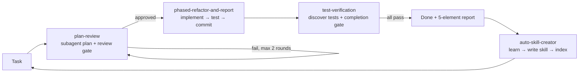

# OpenCode Self-Evolving System + Dev Standards

[](https://github.com/yubuhui/opencode-self-evolving/actions/workflows/ci.yml)
[](https://skills.sh/yubuhui/opencode-self-evolving)

> **English** · [中文](#中文)

A configuration kit that turns [opencode](https://opencode.ai) into a **self-improving agent** with **built-in engineering standards**. Install it and opencode will:

- **Learn automatically** — after solving a hard problem, hitting a pitfall, or discovering a reusable pattern, it writes a reusable *skill* on its own and registers it.
- **Self-maintain** — keeps skills in sync with the codebase and detects conflicts (index drift / overlapping responsibilities / contradicting rules).
- **Enforce standards** — every project inherits a quality baseline, phased refactoring, safe file-encoding, a plan-review gate, and a testing gate.

## Why it's different

Most setups ship a fixed prompt. This kit is a **meta-layer on top of opencode's skill system**: it teaches opencode *how to build its own tooling*, then gates every real change behind subagent-driven planning and automated checks.

## Architecture



## Install

**Install just the skills — open format, works with any agent** (e.g. opencode / Claude Code / Codex / Cursor):

```bash
# opencode
npx skills add yubuhui/opencode-self-evolving -a opencode -g
# or any other agent (Claude Code, Codex, Cursor, ...)
npx skills add yubuhui/opencode-self-evolving -a claude-code -a codex -a cursor -g
```

> The skills are plain `SKILL.md` files following the open [Agent Skills](https://agentskills.io) spec, so they work across agents. If you only want the skills, you don't need opencode at all.

**Full kit for opencode (skills + AGENTS.md discipline + safety permission rules):**

```bash
curl -fsSL https://raw.githubusercontent.com/yubuhui/opencode-self-evolving/main/install.sh | bash
```

Windows (PowerShell) — one line, from anywhere:

```powershell
iex (irm https://raw.githubusercontent.com/yubuhui/opencode-self-evolving/main/install.ps1)
```

The kit installs into `~/.config/opencode/` (AGENTS.md + skills + a minimal `opencode.json` with destructive-command safety rules). **Your model / API key is configured through opencode itself** (`opencode auth login` or your own provider setup) — **this kit never touches it**. Then **restart opencode**.

## Use with DeepSeek Harness (DSH)

The same rules and skills work in DeepSeek Harness. DSH loads user-global instructions from `~/.dsh/AGENTS.md` and discovers skills from `~/.dsh/skills`, `~/.agents/skills`, and project `.dsh/skills`.

1. Install the kit as above (it lands in `~/.config/opencode/`).
2. Copy the DSH rules: `cp dsh/AGENTS.md ~/.dsh/AGENTS.md` (back up an existing file first). On Windows the target is `%USERPROFILE%\.dsh\AGENTS.md`.
3. Point DSH at the shared library:
   - macOS/Linux: `ln -s ~/.config/opencode/skills ~/.dsh/skills` and `ln -s ~/.config/opencode ~/.dsh/rules`
   - Windows: `New-Item -ItemType Junction -Path "$env:USERPROFILE\.dsh\skills" -Target "$env:USERPROFILE\.config\opencode\skills"` and the same for `rules` → `$env:USERPROFILE\.config\opencode`
4. Start a new DSH session. `~/.dsh/AGENTS.md` is loaded every session, skills appear in the session catalog, and the rule self-check runs with `node ~/.dsh/rules/check-rules.mjs`.

> DSH also supports project-level `.dsh/skills` and the shared `~/.agents/skills` root; the `SKILL.md` files here follow the same open format.

## Verify

```bash
npm test   # check-rules.mjs: L1 index / L2 white-bear / L3 mojibake / L4 doc tombstones / L5 kind+budget / L6 trigger overlap / L7 redline conflict + node --test
```

## License

MIT

---

# 中文

## OpenCode 自我进化系统 + 开发规范

一套让 opencode 拥有 **自我进化能力** 和 **内置开发规范** 的全局配置。

装上之后，opencode 会：
- **自动学习**：每解决一个难题、踩过一个坑、发现一个可复用模式，自动沉淀为技能（skill）。
- **自动维护**：技能与代码库同步更新；索引一致、白熊写法、乱码、文档墓碑、kind 与 catalog 预算由 `npm test` 自动检查，触发词交集（职责重叠）与红线段落相斥给候选提醒、人工判定。
- **自动遵循规范**：所有项目默认遵守质量底线、大型改造分阶段、写文件编码安全三条纪律。

## 它是什么

opencode 支持从全局配置目录加载 `skills/` 下的技能和 `AGENTS.md` 里的 always-on 指令。本仓库就是一套**以「技能」为核心的自进化机制**：

```
你完成任务
  └─> 沉淀：把踩过的坑 / 用过的命令 / 摸清的架构写成 SKILL.md
        └─> 索引：登记进 skills/INDEX.md
              └─> 生效：opencode 下次自动加载新技能，你越用越快
                    └─> 维护：技能过时/冲突时自动检测并修正
```

## 目录结构

```
opencode-self-evolving/
├── AGENTS.md                       # 全局 always-on 指令（6 个核心块）
├── check-rules.mjs                 # 规则体检脚本（L1 索引 / L2 白熊 / L3 乱码 / L4 文档墓碑 / L5 结构预算 / L6 职责重叠 / L7 红线相斥）
├── audit-docs.mjs                  # 文档墓碑扫描器（--changed / --staged）
├── package.json                    # npm test = check-rules (L1-L7) + node --test
├── test/                           # 规则工具单测（node --test）
├── git-hooks/                      # 可选：全局 pre-commit 文档审计（默认不启用）
├── skills/
│   ├── INDEX.md                    # 技能索引
│   ├── auto-skill-creator/         # ★ 自我进化核心：自动创建/更新/合并技能
│   ├── quality-baseline/           # 开发质量底线（五项互相约束）
│   ├── docs-stale-audit/           # 改动后文档审计闭环
│   ├── phased-refactor-and-report/ # 大型改造分阶段 + 完成报告
│   ├── plan-review/                # 计划复核：子代理出计划 + 硬清单门禁
│   ├── test-verification/          # 测试总控（界面/场景方法在 references/）
│   ├── white-bear-safe-rules/      # 规则写作：白熊安全三原则
│   └── powershell-utf8-safety/     # 写文件编码安全（防中文乱码）
├── env/                            # 环境档案（本机事实，本地留档不入库）
├── archive/                        # 退役技能留档（本地留档不入库）
├── dsh/AGENTS.md                   # DSH 用户级全局规则（可选安装）
├── opencode.json.example           # 配置模板（密钥留空，需自己填）
├── install.sh                      # macOS/Linux 一行式安装（curl | bash）
├── install.ps1                     # Windows 一键安装
└── .gitignore
```

## 安装

**只用技能（开放格式，任意 agent 都能用）：**

```bash
# opencode
npx skills add yubuhui/opencode-self-evolving -a opencode -g
# 或其他 agent（Claude Code / Codex / Cursor …）
npx skills add yubuhui/opencode-self-evolving -a claude-code -a codex -a cursor -g
```

> 说明：这些技能是标准 `SKILL.md`（[Agent Skills](https://agentskills.io) 开放规范），跨 agent 通用。只想要技能的话，**不装 opencode 也能用**。

**完整套件（面向 opencode：技能 + AGENTS.md 纪律 + 安全权限规则）：**

```bash
curl -fsSL https://raw.githubusercontent.com/yubuhui/opencode-self-evolving/main/install.sh | bash
```

### Windows（PowerShell）—— 一行式，任意目录都行

```powershell
iex (irm https://raw.githubusercontent.com/yubuhui/opencode-self-evolving/main/install.ps1)
```

脚本会：
1. 拷贝 `AGENTS.md`（已有则先备份为 `.bak-时间戳`）。
2. 拷贝 `skills/` 到 `~/.config/opencode/skills/`。
3. 安装自检工具（`check-rules.mjs`、`audit-docs.mjs`、`test/`、`package.json`，`npm test` 可自检 L1-L7 + 单测）；`git-hooks/` 一并拷贝但默认不启用。
4. 若无 `opencode.json` 则创建（**仅安全权限规则**）；已有则跳过，不覆盖你的配置。

> **模型 / API key 由 opencode 自己配置**（`opencode auth login` 或你自己的 provider 设置），**本套件完全不涉及**。安装完成后**重启 opencode** 即生效。

## DSH（DeepSeek Harness）支持

同一套规则和技能也能用于 DSH。DSH 会加载用户级 `~/.dsh/AGENTS.md`，技能从 `~/.dsh/skills`、`~/.agents/skills` 和项目 `.dsh/skills` 发现。

1. 先按上面的方式安装套件（落在 `~/.config/opencode/`）。
2. 复制 DSH 规则：`cp dsh/AGENTS.md ~/.dsh/AGENTS.md`（已有文件先备份）；Windows 目标为 `%USERPROFILE%\.dsh\AGENTS.md`。
3. 让 DSH 看到共享库：
   - macOS/Linux：`ln -s ~/.config/opencode/skills ~/.dsh/skills`、`ln -s ~/.config/opencode ~/.dsh/rules`
   - Windows：`New-Item -ItemType Junction -Path "$env:USERPROFILE\.dsh\skills" -Target "$env:USERPROFILE\.config\opencode\skills"`；`rules` 同理指向 `$env:USERPROFILE\.config\opencode`
4. 新开 DSH 会话：`~/.dsh/AGENTS.md` 每轮加载，技能出现在会话目录里；自检命令 `node ~/.dsh/rules/check-rules.mjs`。

> DSH 也支持项目级 `.dsh/skills` 和共享根 `~/.agents/skills`，这里的 `SKILL.md` 采用同一开放格式，可直接复用。

## 体验「自我进化」

1. 随便做一个稍有难度的任务（修 bug、搭功能、排查环境问题）。
2. 完成后 opencode 会把这次的经验写成 `.opencode/skills/{名称}/SKILL.md` 并登记进 `INDEX.md`。
3. 下次遇到类似问题，它自动调用技能，越用越快、越用越准。

> 提示：技能**默认建在当前项目** `.opencode/skills/`（只对该项目生效）；仅当它是「通用纪律/红线/跨语言平台」或「已在 2+ 个互不相干项目复用」时，才**提升到全局** `~/.config/opencode/skills/`。项目专属踩坑（某项目的库/构建链/脚本）禁止进全局，以免污染所有项目的上下文。

## 核心技能

| 技能 | 作用 |
|------|------|
| **auto-skill-creator** | 自我进化核心。何时建技能、怎么写、怎么同步过时技能、怎么检测冲突（索引一致/白熊/乱码/墓碑/预算自动，触发词交集与红线相斥提醒后人工判定） |
| **quality-baseline** | 五项质量底线：代码结构清晰 / 开发维护方便 / 界面外观统一 / 操作逻辑一致 / 动画效果合适。互相约束，禁止为单一项牺牲另一项 |
| **phased-refactor-and-report** | 大型改造必须拆阶段（实现→测试→提交），失败可独立回滚；非平凡任务完成后必须报告 原状/计划/实际/偏差原因/验收指引（用户界面操作步骤） |
| **plan-review** | 大型/涉规范任务先由子代理出《开发计划》并落盘，主进程按硬清单复核通过才开工（退回重出上限 2 轮） |
| **test-verification** | 先探测项目测试栈，把每阶段落到可执行验证命令；完成前跑受影响范围测试才算真完成（完成门禁） |
| **white-bear-safe-rules** | 写规则/规范时遵循白熊安全三原则：禁令必配正面替代、行为指令与诊断信息分离、正面先行红线兜底 |
| **powershell-utf8-safety** | Windows 写含中文文件必须用 UTF-8（PowerShell 默认 ANSI/GBK 会破坏中文），附乱码检测签名 |

## 自定义

- 想加自己的规范：在 `skills/` 下新建 `<名称>/SKILL.md`，格式参考现有技能（frontmatter 的 `name` + `description` 带触发词），并登记进 `INDEX.md`。opencode 会自动加载。
- 想改默认纪律：直接编辑对应 SKILL.md 或 AGENTS.md 里的段落。
- 技能冲突时：遵循 auto-skill-creator 的 L1/L2/L3 检测规则排查。

## 安全说明

- 本仓库只含占位符，无任何真实 API Key / 密钥。
- 请勿把你的 `opencode.json`（含密钥）提交到公开仓库。

## License

MIT